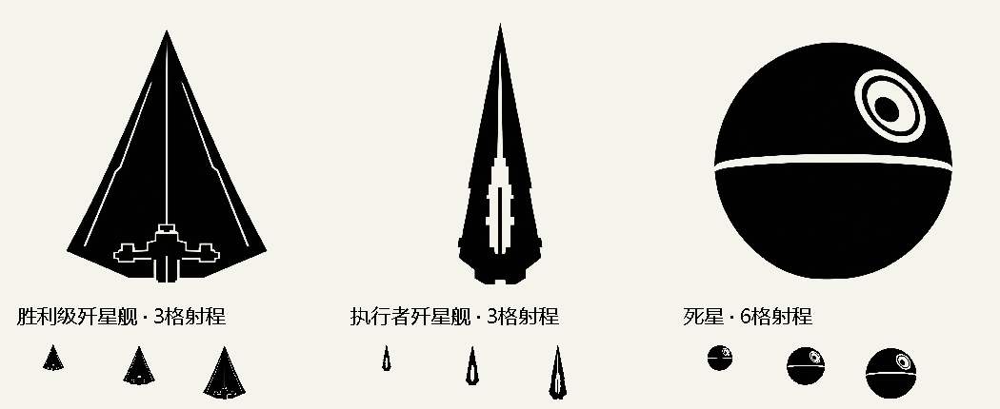

# 星际舰队：Unciv 电脑端完整扩展

胜利级歼星舰、执行者歼星舰、死星；支持跨海陆山地移动、任意空军搭载、独立陆军/平民运输舱，以及母舰摧毁时载员一并摧毁。

**适配 Windows 电脑端 Unciv 4.22.6-patch1。使用现有游戏加载扩展，不包含独立游戏。原版 Android/iOS 的“从 URL 下载模组”不能安装本完整扩展。**

## 下载和安装

1. 用浏览器打开 [v1.0.0 发布页](https://github.com/zjmnb66611/Unciv-Stellar-Fleet-Desktop/releases/tag/v1.0.0)，下载 `Stellar-Fleet-Desktop-1.0.0.zip`。
2. 解压到普通文件夹。在解压后的目录中运行：

```powershell
powershell.exe -NoProfile -ExecutionPolicy Bypass -File .\install.ps1 -GameDirectory "D:\你的Unciv目录"
```

3. 游戏若已打开，请自行保存退出。随后使用已有的 Unciv 增强入口，或游戏目录新增的 `启动星际舰队.cmd`。
4. 新建对局，在扩展模组列表勾选 **Stellar Fleet（星际舰队）**。旧存档不会因下载或安装而自动加入本模组。

只有同版本原版游戏也可以安装；星际舰队启动器会按是否存在来加载已有的东风优化和一键购买。需要完整核组织审批机制时，使用 `启动星际舰队与核组织.cmd`，并保留对应核组织扩展。

## 单位参数

|单位|空军位|陆军/平民共用位|铁|铀|金币价|防御/远程战斗力|生命|移动/射程|
|---|---:|---:|---:|---:|---:|---|---:|---|
|胜利级歼星舰|2|1|10|3|1000|180 / 200|100|6 / 3|
|执行者歼星舰|4|2|20|6|3000|260 / 300|100|6 / 3|
|死星|5|4|40|15|禁止购买|500 / 600|100|4 / 6|

所有文明可用。完成隐形技术、机器人学和高级弹道学后解锁，归入信息时代。战斗力不是固定扣血；实际伤害沿用原版规则。没有额外核爆或范围清除效果。铁、铀按原版持续占用。



## 操作与兼容

- 在原生单位行动栏点击“星际机库 / 运输舱”，相邻友方单位可登舰；空军舱与地面舱分别计数。
- 母舰被战斗、核爆或删除摧毁时，舰上全部载员一并摧毁。已卸载单位不受影响。
- 不覆盖其他模组的单位、科技、时代或晋升；使用原生远程海军晋升树。
- 使用版本匹配的内存扩展，保留原始 Unciv.jar；不向原生 Unciv.json 注入代理参数。
- 原版、华夏标准版、Continued 配套版、Worlds 配套版及已有核组织/东风/一键购买组合已做引擎测试。Continued 与 Worlds 仍需分别配套，不能同时勾选互斥扩展。

共 7 组引擎验证、累计 994 项断言通过，覆盖实际购买、资源、双舱满载、跨地形移动、JSON 存档恢复、卸载和母舰摧毁。四组规则增量校验未引入新问题。尚未在实际游戏窗口完成新按钮的点击和布局验收，也未新增 AI 地面登舰规划。

详细安装、玩法、回退和限制见 [使用说明](使用说明.md)。源码在 [source](source)，素材和提示词在 [素材源文件](素材源文件)。源码构建脚本保留原开发工作区结构，重新构建需要匹配版本的游戏 JAR、Java 21、ECJ 和 ASM 工具链。

这是玩家制作的科幻主题扩展，不是官方产品。代码按 MPL-2.0 提供，ASM 依照随包 BSD-3-Clause 许可；图标为依据提供的参考图生成的黑色剪影。
